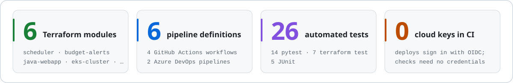
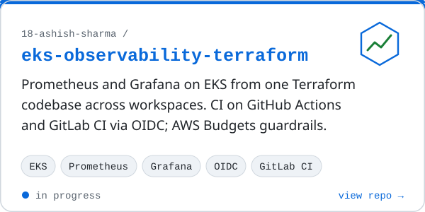
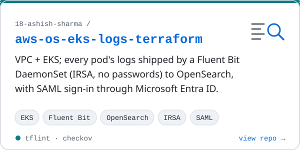
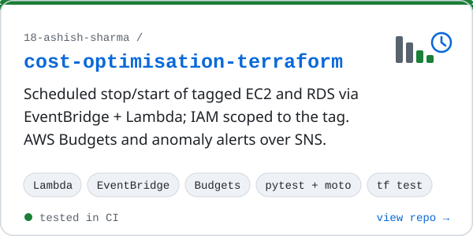
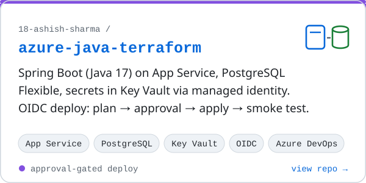
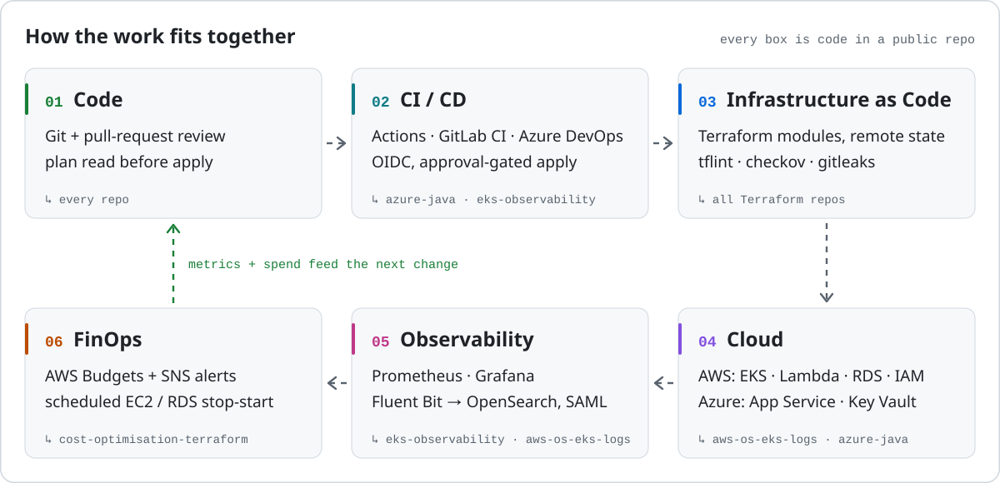
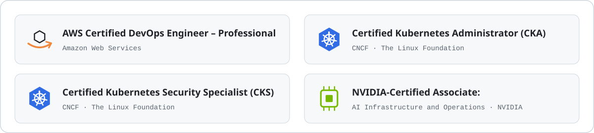

<picture>
  <source media="(max-width: 600px) and (prefers-color-scheme: dark)" srcset="assets/banner-m-dark.svg">
  <source media="(max-width: 600px)" srcset="assets/banner-m-light.svg">
  <source media="(prefers-color-scheme: dark)" srcset="assets/banner-dark.svg">
  
</picture>

I build cloud platforms as code: Kubernetes on AWS, Terraform from the network up to the dashboards, pipelines that deploy without long-lived keys, and monitoring and cost controls in the same pull request as the resources. 7+ years across AWS and Azure. Based in India (IST, UTC+5:30).

<picture>
  <source media="(max-width: 600px) and (prefers-color-scheme: dark)" srcset="assets/numbers-m-dark.svg">
  <source media="(max-width: 600px)" srcset="assets/numbers-m-light.svg">
  <source media="(prefers-color-scheme: dark)" srcset="assets/numbers-dark.svg">
  
</picture>

Live pipeline status. Every pull request runs <code>terraform fmt</code>, <code>validate</code>, <code>tflint</code> and <code>checkov</code> (SARIF to the Security tab) without cloud credentials; in the AWS repos <code>gitleaks</code> also runs as a pre-commit hook.

## Featured work

<a href="https://github.com/18-ashish-sharma/eks-observability-terraform"><picture>
  <source media="(max-width: 600px) and (prefers-color-scheme: dark)" srcset="assets/card-m-eks-observability-terraform-dark.svg">
  <source media="(max-width: 600px)" srcset="assets/card-m-eks-observability-terraform-light.svg">
  <source media="(prefers-color-scheme: dark)" srcset="assets/card-eks-observability-terraform-dark.svg">
  
</picture></a>
<a href="https://github.com/18-ashish-sharma/aws-os-eks-logs-terraform"><picture>
  <source media="(max-width: 600px) and (prefers-color-scheme: dark)" srcset="assets/card-m-aws-os-eks-logs-terraform-dark.svg">
  <source media="(max-width: 600px)" srcset="assets/card-m-aws-os-eks-logs-terraform-light.svg">
  <source media="(prefers-color-scheme: dark)" srcset="assets/card-aws-os-eks-logs-terraform-dark.svg">
  
</picture></a>
<a href="https://github.com/18-ashish-sharma/cost-optimisation-terraform"><picture>
  <source media="(max-width: 600px) and (prefers-color-scheme: dark)" srcset="assets/card-m-cost-optimisation-terraform-dark.svg">
  <source media="(max-width: 600px)" srcset="assets/card-m-cost-optimisation-terraform-light.svg">
  <source media="(prefers-color-scheme: dark)" srcset="assets/card-cost-optimisation-terraform-dark.svg">
  
</picture></a>
<a href="https://github.com/18-ashish-sharma/azure-java-terraform"><picture>
  <source media="(max-width: 600px) and (prefers-color-scheme: dark)" srcset="assets/card-m-azure-java-terraform-dark.svg">
  <source media="(max-width: 600px)" srcset="assets/card-m-azure-java-terraform-light.svg">
  <source media="(prefers-color-scheme: dark)" srcset="assets/card-azure-java-terraform-dark.svg">
  
</picture></a>

Also: <a href="https://github.com/18-ashish-sharma/aws-terraform-react-js">aws-terraform-react-js</a> (React on S3 with Terraform) · <a href="https://github.com/18-ashish-sharma/azure-react-storage">azure-react-storage</a> (React on Azure Storage with Terraform). Both are being tidied up.

 

<picture>
  <source media="(max-width: 600px) and (prefers-color-scheme: dark)" srcset="assets/infra-map-m-dark.svg">
  <source media="(max-width: 600px)" srcset="assets/infra-map-m-light.svg">
  <source media="(prefers-color-scheme: dark)" srcset="assets/infra-map-dark.svg">
  
</picture>

## Currently

- **Running a multi-service platform on Kubernetes** at work: Helm charts per service, CI that builds and tests every change, CD pipelines that roll releases out, and PostgreSQL behind it.
- **Writing observability and cost guardrails as code:** Prometheus and Grafana on EKS, budgets and off-hours scheduling in Terraform.
- **Raising the bar on my public repos:** pinned providers, CI gates on every pull request, and READMEs that describe exactly what the code does.

## Certifications

<picture>
  <source media="(max-width: 600px) and (prefers-color-scheme: dark)" srcset="assets/certs-m-dark.svg">
  <source media="(max-width: 600px)" srcset="assets/certs-m-light.svg">
  <source media="(prefers-color-scheme: dark)" srcset="assets/certs-dark.svg">
  
</picture>

## Toolbox

| Area | Tools |
|---|---|
| Cloud | AWS (EKS, Lambda, EventBridge, RDS, OpenSearch, IAM, Budgets) · Azure (App Service, PostgreSQL Flexible, Key Vault, Entra ID) |
| Infrastructure as code | Terraform: modules, remote state with locking, workspaces, `terraform test` |
| Containers | Kubernetes, Amazon EKS, Helm, Fluent Bit |
| CI/CD | GitHub Actions, GitLab CI, Azure DevOps · OIDC / workload identity federation |
| Observability | Prometheus, Grafana, OpenSearch, CloudWatch, Application Insights |
| Security | tflint, checkov, gitleaks, least-privilege IAM, IRSA, SAML SSO |
| FinOps | AWS Budgets, Cost Anomaly Detection, scheduled stop/start, rightsizing |
| Languages | HCL, Python, Bash, YAML |

## How I work

- **Everything as code.** Infrastructure, pipelines, dashboards and alerts live in Git and change through review. A console click that isn't in code is drift.
- **Least privilege by default.** CI gets short-lived credentials through OIDC, workloads get scoped roles, people sign in through SSO.
- **Read the plan before the apply.** Production applies run a saved plan behind an approval gate, never a fresh one.
- **Observable and costed from day one.** Metrics, logs, budgets and off-hours schedules ship with the service, not after the first incident or the first bill.

---

Questions about any of this work: open an issue on the repository it relates to. Browse everything on the <a href="https://github.com/18-ashish-sharma?tab=repositories">repositories tab</a>.
